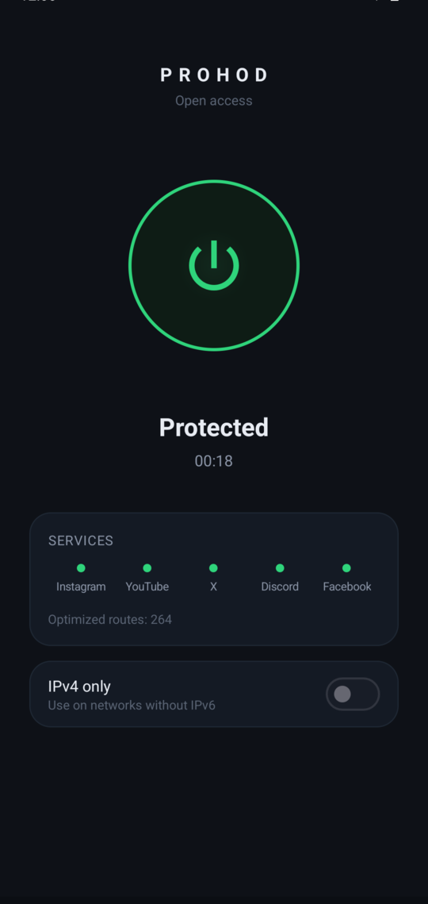
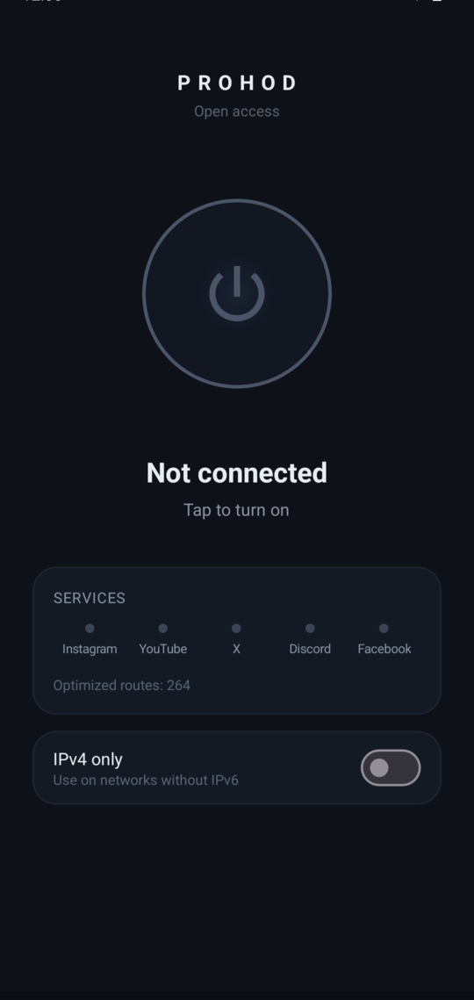

# Prohod

Open blocked sites without a VPN server. Prohod runs on your machine and reshapes the
way your browser talks to a site so the ISP's filter stops recognizing it. You don't make
an account or rent a server, and your traffic never leaves through someone else's machine.

**Platforms:** macOS, Linux, Android (Windows later). One button: on / off.

<p align="center">
  
  
</p>

## What it actually does

A lot of "blocking" happens at the TLS handshake. The
provider reads the site name (SNI) in the first packet and drops the connection. Prohod
splits and reorders that first packet so the name never appears as one clean string, while
the real server still understands it. The site opens; the filter sees noise.

It only helps with one of the ways a site gets blocked:

| How a site is blocked | Example | Prohod helps? |
|---|---|---|
| ISP filters the TLS handshake (SNI/DPI) | Instagram, YouTube, Facebook | **Yes** |
| ISP drops all packets to the service's IPs | Telegram | No, needs an outside relay |
| The site itself refuses your country | ChatGPT / OpenAI | No, needs a foreign exit IP |

So Prohod opens the big DPI-filtered sites and leaves everything else alone. For the other
two cases there is no local trick: the traffic has to leave through another IP, which is a
VPN or a proxy.

## How it works

```
your apps ──system proxy──▶ local SOCKS5 ──▶ engine ──▶ internet
                                             reshapes the TLS ClientHello
```

- A small SOCKS5 server listens on loopback. Your system proxy (or, on Android, a local
  VPN tunnel) points at it.
- The engine applies a reshaping method per destination. Known blocked domains get a method
  that was measured to work for them; everything else goes out untouched first, and only
  falls back to a method if a block is detected. Working methods are cached per address.
- Normal sites stay fast and nothing about them changes. The method list comes from testing
  against a real censoring ISP.

The engine is [ByeDPI](https://github.com/hufrea/byedpi) (MIT). On Android the tunnel is
[hev-socks5-tunnel](https://github.com/heiher/hev-socks5-tunnel) (MIT). The desktop app is
[Wails](https://wails.io) (Go + a small web UI).

## Install / build

You need Go 1.24+, Node 20+, and a C compiler. Android also needs the Android SDK and NDK.

**Desktop (macOS / Linux):**
```sh
make engine     # compiles the engine for your OS
make app        # builds the app into build/bin/
make dev        # run with hot reload
```

**Android:**
```sh
scripts/android-natives.sh                 # builds the native libraries (needs NDK)
cd android && ./gradlew :app:assembleRelease
# APK: android/app/build/outputs/apk/release/app-release.apk
```

First launch asks for the VPN / proxy permission. That is the OS being careful; Prohod only
ever listens on `127.0.0.1` and restores your proxy settings on exit, on quit, and even if
it crashes (a tiny guard process puts them back).

## What opens

Out of the box it carries a few hundred domains that are blocked by DPI and have a known
working method: Instagram, YouTube, Facebook, Threads, WhatsApp web, and a long tail of news
and service sites. Anything not on the list is tried automatically if it looks blocked.

Sites that are blocked by IP (Telegram) or geo-blocked by the site (ChatGPT) will not open.
See the table above.

## Safety and privacy

- Everything runs locally. No telemetry, no accounts, no update pings.
- The proxy only listens on loopback and only accepts CONNECT.
- Your original proxy settings are saved and restored; you are never left offline.

## Credits

Built on [ByeDPI](https://github.com/hufrea/byedpi),
[hev-socks5-tunnel](https://github.com/heiher/hev-socks5-tunnel), and [Wails](https://wails.io).
Domain lists draw on community sources like
[itdoginfo/allow-domains](https://github.com/itdoginfo/allow-domains) and
[re:filter](https://github.com/1andrevich/Re-filter-lists).

## License

MIT. See [LICENSE](LICENSE). Bundled components keep their own licenses, listed in
[LICENSES](LICENSES).

---

🇷🇺 **[Читать по-русски →](docs/README.ru.md)**

<sub>Keywords: DPI bypass, deep packet inspection, SNI filtering, unblock Instagram, unblock
YouTube, censorship circumvention, ByeDPI GUI, zapret alternative, Amnezia alternative,
no-VPN unblocker, macOS, Linux, Android.</sub>
