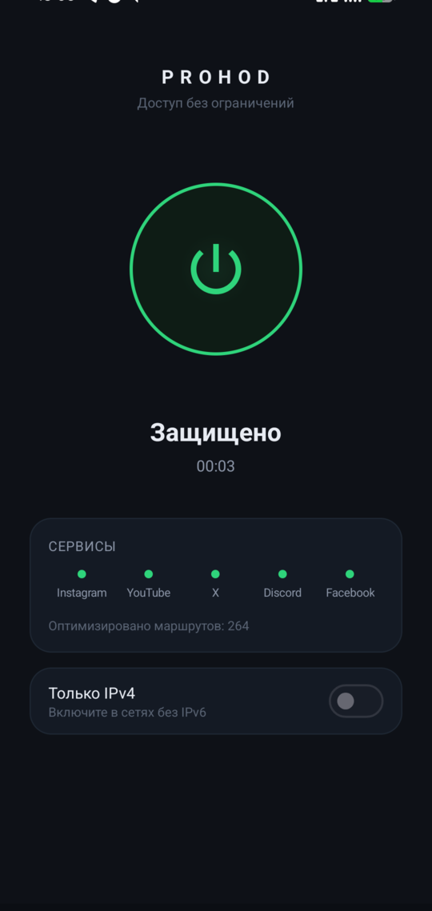
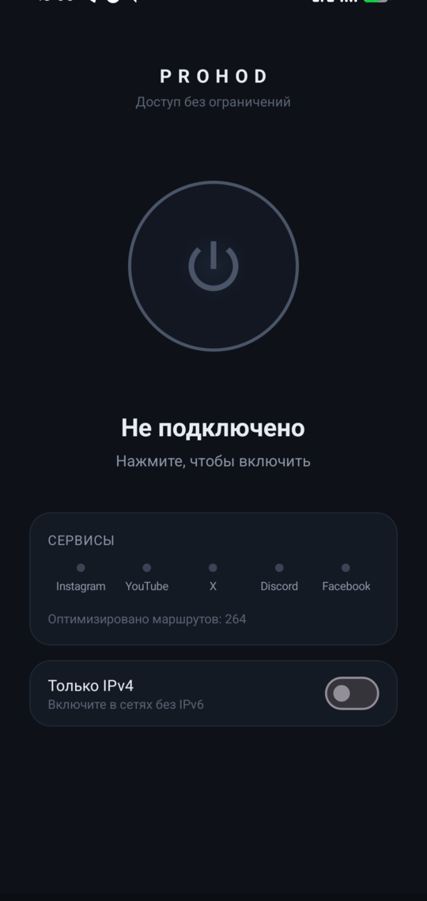

# Prohod

Открывает заблокированные сайты без VPN-сервера. Prohod работает на вашем устройстве и
меняет то, как браузер здоровается с сайтом, чтобы фильтр провайдера перестал его узнавать.
Не нужно заводить аккаунт или арендовать сервер, и трафик не идёт через чужую машину.

**Платформы:** macOS, Linux, Android (Windows позже). Одна кнопка: вкл / выкл.

<p align="center">
  
  
</p>

## Что он реально делает

Большая часть блокировок в России и соседних странах срабатывает на этапе TLS-рукопожатия.
Провайдер читает имя сайта (SNI) в первом пакете и рвёт соединение. Prohod разбивает и
переставляет этот первый пакет так, что имя не видно одной цельной строкой, а сервер его
по-прежнему понимает. Сайт открывается, фильтр видит мусор.

Вот честная часть, которую большинство инструментов опускают: это помогает только против
одного типа блокировки.

| Как заблокирован сайт | Пример | Prohod помогает? |
|---|---|---|
| Провайдер фильтрует рукопожатие (SNI/DPI) | Instagram, YouTube, Facebook | **Да** |
| Провайдер роняет все пакеты к IP сервиса | Telegram | Нет — нужен внешний узел |
| Сайт сам отказывает вашей стране | ChatGPT / OpenAI | Нет — нужен выход через чужой IP |

Prohod открывает крупные сайты, срезанные по DPI, а остальное не трогает. Для двух других
случаев локального трюка нет: трафик должен выйти через другой IP, а это VPN или прокси.

## Как это устроено

```
ваши приложения ──системный прокси──▶ локальный SOCKS5 ──▶ движок ──▶ интернет
                                                            меняет TLS ClientHello
```

- Небольшой SOCKS5-сервер слушает только на loopback. Системный прокси (а на Android —
  локальный VPN-туннель) указывает на него.
- Движок применяет свой метод под каждый адрес. Известные заблокированные домены получают
  метод, который для них измеренно работает; остальное сначала идёт без изменений и
  переключается на метод, только если замечена блокировка. Рабочий метод кешируется по адресу.
- Обычные сайты остаются быстрыми, в них ничего не меняется. Список методов собран по
  полевому тесту на реальном цензурирующем провайдере, а не на глаз.

Движок — [ByeDPI](https://github.com/hufrea/byedpi) (MIT). На Android туннель —
[hev-socks5-tunnel](https://github.com/heiher/hev-socks5-tunnel) (MIT). Десктоп сделан на
[Wails](https://wails.io) (Go плюс лёгкий веб-интерфейс).

## Установка / сборка

Нужны Go 1.24+, Node 20+ и компилятор C. Для Android ещё Android SDK и NDK.

**Десктоп (macOS / Linux):**
```sh
make engine     # собрать движок под вашу ОС
make app        # собрать приложение в build/bin/
make dev        # запуск с горячей перезагрузкой
```

**Android:**
```sh
scripts/android-natives.sh                 # собрать нативные библиотеки (нужен NDK)
cd android && ./gradlew :app:assembleRelease
# APK: android/app/build/outputs/apk/release/app-release.apk
```

При первом запуске система спросит разрешение на VPN / прокси. Это ОС осторожничает: Prohod
слушает только `127.0.0.1` и возвращает настройки прокси при выходе, при закрытии и даже при
падении (маленький процесс-сторож ставит их обратно).

## Что открывается

Из коробки приложение несёт несколько сотен доменов, заблокированных по DPI, у которых есть
рабочий метод: Instagram, YouTube, Facebook, Threads, веб-WhatsApp и длинный хвост новостных
и сервисных сайтов. Всё, чего нет в списке, пробуется автоматически, если выглядит
заблокированным.

Сайты, заблокированные по IP (Telegram), или с геоблоком на стороне сайта (ChatGPT), не
откроются — смотрите таблицу выше.

## Безопасность и приватность

- Всё работает локально. Ни телеметрии, ни аккаунтов, ни запросов на обновление.
- Прокси слушает только loopback и принимает только CONNECT.
- Исходные настройки прокси сохраняются и восстанавливаются, без интернета вы не останетесь.

## Благодарности

Собрано на [ByeDPI](https://github.com/hufrea/byedpi),
[hev-socks5-tunnel](https://github.com/heiher/hev-socks5-tunnel) и [Wails](https://wails.io).
Списки доменов опираются на сообщество: [itdoginfo/allow-domains](https://github.com/itdoginfo/allow-domains)
и [re:filter](https://github.com/1andrevich/Re-filter-lists).

## Лицензия

MIT, см. [LICENSE](../LICENSE). У встроенных компонентов свои лицензии, они перечислены в
[LICENSES](../LICENSES).
